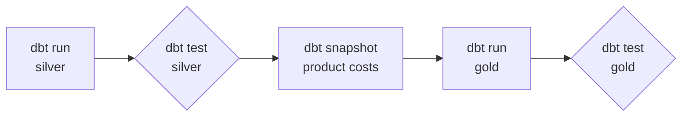

<p align="center"></p>

The **Apache Airflow** setup that runs the [kente_dw](https://github.com/kente001/kente_dw) warehouse build every day, in Docker.

## The pipeline

One DAG, `kente_dwh_pipeline`, scheduled daily at 06:00. Each step is a dbt command, and each step only runs if the one before it passed.



If a test fails, the run stops there, so data that fails a quality check never reaches the gold tables that reports read from. Failed tasks retry once after two minutes.

## What's in here

| File | Purpose |
|---|---|
| `dags/kente_dwh_pipeline.py` | The DAG: five `BashOperator` tasks calling dbt |
| `Dockerfile` | Airflow 3.3.0 image with `dbt-core 1.7.19` and `dbt-mysql 1.7.0` added |
| `docker-compose.yaml` | Airflow services (with Postgres and Redis) for local use |

## Run it

1. Clone this repo and [kente_dw](https://github.com/kente001/kente_dw).
2. In `docker-compose.yaml`, change the volume that mounts the dbt project to the path of your `kente_dw` clone. It is mounted at `/opt/airflow/kente_dw`, and dbt profiles are read from `/opt/airflow/dbt-profiles`.
3. Start it:

```bash
docker compose up --build
```

4. Open the Airflow UI and trigger `kente_dwh_pipeline`.

The compose file uses Airflow's default local credentials. They are for local development only.

---

<sub>Part of <b>the silent data</b> · Kennedy Njoroge</sub>
